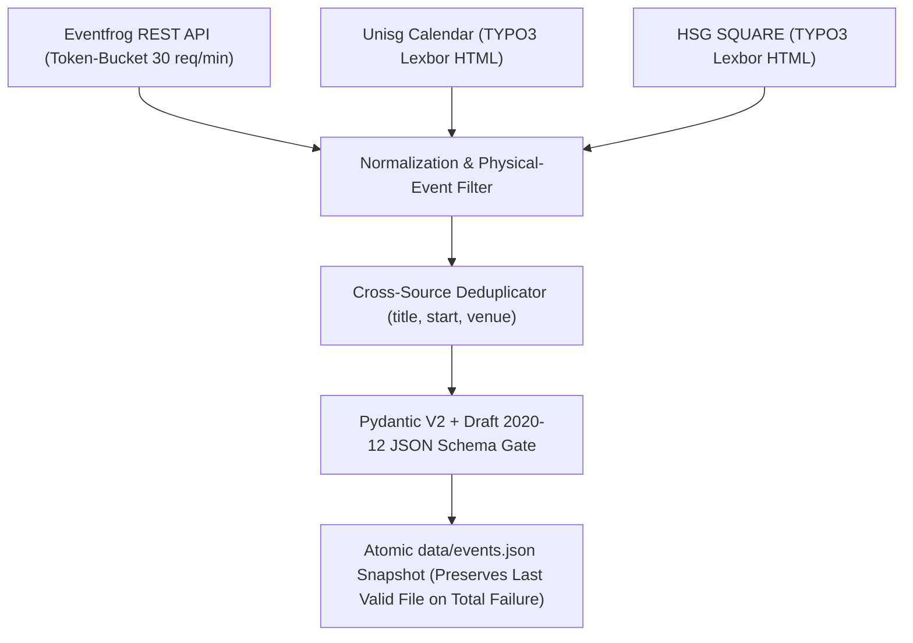

# Event Aggregation Pipeline

A fault-isolated Python data pipeline that aggregates heterogeneous physical event feeds (REST APIs + TYPO3 HTML portals), deduplicates overlapping entities across sources, normalizes multilingual dates/taxonomies, and enforces Draft 2020-12 JSON Schema validation (`docs/events.schema.json`).

Ships configured out of the box for St. Gallen, Switzerland (`Eventfrog API`, `University of St. Gallen`, and `HSG SQUARE`), and is structured to plug in additional cities or upstream providers cleanly.

---

## Architecture



---

## Features

- **Multi-Source Aggregation**:
  - **Eventfrog Public API** (`api.eventfrog.net`): REST collector with built-in token-bucket rate limiting (max 30 requests/minute).
  - **University of St. Gallen (Unisg)** (`unisg.ch/...`): Public academic calendar, lectures, and conferences parsed via `selectolax.lexbor`.
  - **HSG SQUARE** (`hsg-square.ch/...`): Campus dialogue, cultural exhibitions, and workshops.
- **Strict Schema Compliance**: Every output validates 100% against `docs/events.schema.json` via Draft 2020-12 JSON Schema (`jsonschema` with format checking).
- **Fault-Isolated Execution**: Each upstream source runs inside its own failure boundary. If one source fails, remaining sources still complete; if all sources fail, the previous valid output file is preserved.
- **Cross-Source Deduplication**: Duplicates matching `(title, start, venue)` are merged deterministically, prioritizing Eventfrog structured metadata.
- **Physical Event Enforcement**: Automatically filters out online-only webinars and virtual meetings while preserving hybrid on-premise events.
- **Minimal Standalone Dependencies**: Built strictly on `httpx`, `jsonschema`, `pydantic`, and `selectolax` — no external database or heavyweight framework required.

---

## Directory Structure

```text
.
├── .github/workflows/
│   └── events.yml                      # Scheduled GitHub Actions refresh workflow
├── data/
│   └── events.json                     # Canonical validated output snapshot
├── docs/
│   └── events.schema.json              # Draft 2020-12 JSON Schema
├── src/event_aggregation_pipeline/
│   ├── deduplicator.py                 # Cross-source entity deduplication
│   ├── eventfrog.py                    # Eventfrog REST client & rate limiter
│   ├── models.py                       # Pydantic data contracts & PipelineConfig
│   ├── normalization.py                # Text sanitization, date/TZ & taxonomy mapping
│   ├── pipeline.py                     # Fault-isolated source orchestration
│   └── typo3_scraper.py                # Lexbor CSS card parser (Unisg + HSG Square)
├── tests/
│   ├── fixtures/                       # Sanitized offline HTML & JSON payloads
│   ├── test_parser.py                  # Offline parser unit tests
│   └── test_pipeline.py                # Offline pipeline integration tests
├── .env.example                        # Sample environment variables
├── justfile                            # Local development task recipes
├── pyproject.toml                      # Project configuration and dependencies
├── requirements.txt                    # Pinned production dependencies
├── run.py                              # Pipeline CLI entry point
└── validate.py                         # JSON Schema validator CLI
```

---

## Setup & Installation

### Requirements

- Python 3.11 or higher
- (Optional) `uv` for fast virtualenv management and `just` for task recipes.

### Option A: Standard `pip` (Production)

```bash
python3 -m venv .venv
source .venv/bin/activate
pip install --upgrade pip
pip install -r requirements.txt
```

### Option B: Modern `uv` (Development)

```bash
uv sync
```

### Environment Configuration

Copy `.env.example` to `.env` and provide your Eventfrog API key:

```bash
cp .env.example .env
```

Edit `.env`:

```ini
EVENTFROG_API_KEY=your_actual_api_key_here
```

> **Note:** If no API key is provided, the pipeline logs a warning and continues with the HTML sources (Unisg and HSG Square) without failing.

---

## How to Run

### Live Execution

Fetch events across all sources and write to `data/events.json`:

```bash
python run.py
# or: just run
```

### Offline Execution (Fixtures)

Test the full aggregation, normalization, deduplication, and export flow offline using sanitized fixtures:

```bash
python run.py --offline
# or: just run --offline
```

### Custom Output Path and Logging

```bash
python run.py --output /tmp/custom_events.json --log-level DEBUG
```

---

## Schema Validation

Validate `data/events.json` against the Draft 2020-12 schema:

```bash
python validate.py
# or: just validate
```

Validate a custom path:

```bash
python validate.py /path/to/events.json --schema docs/events.schema.json
```

---

## Category Mapping Table

Every physical event is classified into one of six standardized categories required by `docs/events.schema.json`:

| Category | Description | Matching Rules & Trigger Keywords |
| :--- | :--- | :--- |
| `nightlife_music` | Concerts, DJ sets, club nights, parties, live music, jazz | `party`, `club`, `konzert`, `concert`, `jazz`, `live music`, `dj` |
| `sports` | Football, sports tournaments, fitness, yoga, running | `sport`, `fussball`, `football`, `match`, `turnier`, `lauf`, `yoga` |
| `culture` | Theatre, film screenings, cinema, art exhibitions, museums | `theater`, `kino`, `film`, `dokfilm`, `cinema@square`, `ausstellung`, `museum`, `kunst`, `bühne` |
| `talks_university` | Lectures, academic panels, symposiums, public talks | `vorlesung`, `antrittsvorlesung`, `symposium`, `tagung`, `kongress`, `kolloquium`, `workshop`, `lecture`, `talk` |
| `food_drinks` | Wine tastings, dinners, brunches, culinary events, apéros | `lunch`, `dinner`, `degustation`, `apéro`, `brunch`, `kulinarik`, `gastronomie`, `food`, `wine` |
| `other` | Miscellaneous physical events not matching above taxonomies | Fallback classification |

Online-only events (`webinar`, `zoom meeting`, `virtuell`) are automatically excluded; hybrid events with physical venues are retained.

---

## Configuration

All pipeline parameters are centralized in `PipelineConfig` within `src/event_aggregation_pipeline/models.py`:

| Parameter | Default Value | Description |
| :--- | :--- | :--- |
| `location_name` | `"St. Gallen"` | Center anchor city |
| `latitude` | `47.4245` | Geographic anchor latitude |
| `longitude` | `9.3767` | Geographic anchor longitude |
| `radius_km` | `15.0` | Event query radius in kilometers |
| `window_days` | `30` | Time horizon for upcoming events |
| `timezone` | `"Europe/Zurich"` | Timezone for ISO 8601 formatting |
| `schedule_cron` | `"0 5 * * 1"` | Scheduled cron expression (Monday 05:00 Zurich) |
| `output_path` | `"data/events.json"` | Default export path |

Pass a custom `PipelineConfig` instance to `run_pipeline(config=custom_cfg)` to target another region or schedule.

---

## Automated Refresh (GitHub Actions)

`.github/workflows/events.yml` runs automatically every Monday at 05:00 Europe/Zurich (`0 4 * * 1` UTC) and supports manual `workflow_dispatch`:

1. Sets up Python 3.11 and installs pinned dependencies from `requirements.txt`.
2. Runs `python run.py` using `EVENTFROG_API_KEY` from repository secrets.
3. Validates `data/events.json` against `docs/events.schema.json`.
4. Commits and pushes the updated dataset back to `main` if changes are detected.

---

## How to Add a New Source

Adding a new upstream provider requires four steps:

### 1. Register Source Enum

In `src/event_aggregation_pipeline/models.py`, add the source identifier:

```python
class EventSource(StrEnum):
    EVENTFROG = "eventfrog"
    HSG_CALENDAR = "hsg_calendar"
    HSG_SQUARE = "hsg_square"
    MY_NEW_SOURCE = "my_new_source"
```

### 2. Implement Collector / Parser

Create `src/event_aggregation_pipeline/my_new_source.py`:

```python
from collections.abc import Sequence
from .models import Event, EventCategory, EventSource, to_zurich_iso
from .normalization import clean_text, map_category


def scrape_my_new_source() -> Sequence[Event]:
    events: list[Event] = []
    # ... extraction logic ...
    return events
```

### 3. Register in Pipeline Loader

In `src/event_aggregation_pipeline/pipeline.py`, import the scraper, add `EventSource.MY_NEW_SOURCE` to `_SOURCE_ORDER`, and register it in `_build_source_loaders`:

```python
loaders[EventSource.MY_NEW_SOURCE] = lambda: scrape_my_new_source()
```

### 4. Add Offline Fixture and Tests

- Save a sample response to `tests/fixtures/my_new_source.html`.
- Run `just sanitize-fixture tests/fixtures/my_new_source.html`.
- Add unit parser tests to `tests/test_parser.py`.

---

## Development & Verification

```bash
just check    # ruff, basedpyright, gitleaks, offline pytest suite
just fmt      # format source code
just test     # run offline pytest suite
just secrets  # scan for inadvertent secrets or tokens
```

All tests execute completely offline without external network dependencies.
