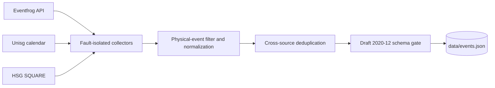

# Event Aggregation Pipeline

[](https://github.com/flasheddy/event-aggregation-pipeline/actions/workflows/ci.yml)

A fault-isolated Python pipeline that collects physical events from the Eventfrog API and two TYPO3 portals, normalizes and deduplicates overlapping records across sources, and writes a snapshot validated against a Draft 2020-12 JSON Schema.

It ships configured for St. Gallen, Switzerland: Eventfrog, the University of St. Gallen calendar, and HSG SQUARE.

## Architecture



Each source runs inside its own failure boundary. If every source fails, the previous valid `data/events.json` is preserved instead of being overwritten.

## Quickstart

Requires Python 3.11+ and [uv](https://docs.astral.sh/uv/). [just](https://github.com/casey/just) is optional but used below.

```bash
git clone https://github.com/flasheddy/event-aggregation-pipeline.git
cd event-aggregation-pipeline
uv sync
cp .env.example .env   # add EVENTFROG_API_KEY for live collection

just run --offline     # full pipeline against sanitized fixtures
just validate          # check data/events.json against the schema
```

Live collection:

```bash
just run
```

Without `EVENTFROG_API_KEY`, the Eventfrog collector is skipped and the two HTML sources still run. The scripts are also runnable directly with `uv run python run.py [--offline]` and `uv run python validate.py [events.json]`; export the key in your shell when invoking them directly.

## Output

`data/events.json` contains one object with a `generated_at` timestamp and an `events` array. The canonical contract is `docs/events.schema.json`. Abridged example:

```json
{
  "generated_at": "2026-11-21T05:00:00+01:00",
  "events": [
    {
      "id": "eventfrog:102938475",
      "source": "eventfrog",
      "title": "St. Gallen Jazz Night",
      "start": "2026-11-20T20:00:00+01:00",
      "venue_name": "Kugl St. Gallen",
      "address": "Güterbahnhofstrasse 4, 9000 St. Gallen"
    }
  ]
}
```

Every event carries a stable `<source>:<source_id>` identity, Zurich-offset timestamps, venue details, a fixed category, language, optional coordinates/pricing/URLs, and `last_seen_at`. Online-only events are excluded; hybrid events with a physical venue are kept.

Cross-source duplicates match on normalized `(title, start, venue)` and prefer Eventfrog metadata, then HSG SQUARE, then the university calendar.

## Sources

| Source | Adapter | Input |
| :--- | :--- | :--- |
| Eventfrog | `eventfrog.py` | JSON API, rate-limited to 30 requests per minute |
| Unisg calendar | `typo3_scraper.py` | Paginated TYPO3 HTML event cards |
| HSG SQUARE | `typo3_scraper.py` | Paginated TYPO3 HTML event cards |

## Configuration

`PipelineConfig` in `src/event_aggregation_pipeline/models.py` controls collection and output. Pass a custom instance to `run_pipeline(config=...)`.

| Setting | Default | Purpose |
| :--- | :--- | :--- |
| `location_name` | `"St. Gallen"` | Eventfrog location query |
| `radius_km` | `15.0` | Eventfrog search radius |
| `window_days` | `30` | Keep events starting within this many days |
| `eventfrog_api_url` | `https://api.eventfrog.net/v1/events` | Eventfrog endpoint |
| `unisg_calendar_url` | `https://www.unisg.ch/de/news/veranstaltungen/veranstaltungskalender/` | University calendar |
| `hsg_square_url` | `https://www.hsg-square.ch/de/programm/` | HSG SQUARE program |
| `output_path` | `"data/events.json"` | Snapshot destination |

## Development

```bash
just check    # ruff, basedpyright, gitleaks, pytest
just fmt      # auto-format with ruff
just test     # offline pytest suite
just typecheck
```

All tests run offline against sanitized fixtures in `tests/fixtures/`.

CI (`.github/workflows/ci.yml`) runs `ruff`, `basedpyright`, and `pytest` on every push and pull request. `.github/workflows/events.yml` refreshes the dataset weekly from the public sources; set the `EVENTFROG_API_KEY` repository secret to include Eventfrog.

## License

MIT. See [LICENSE](LICENSE).
